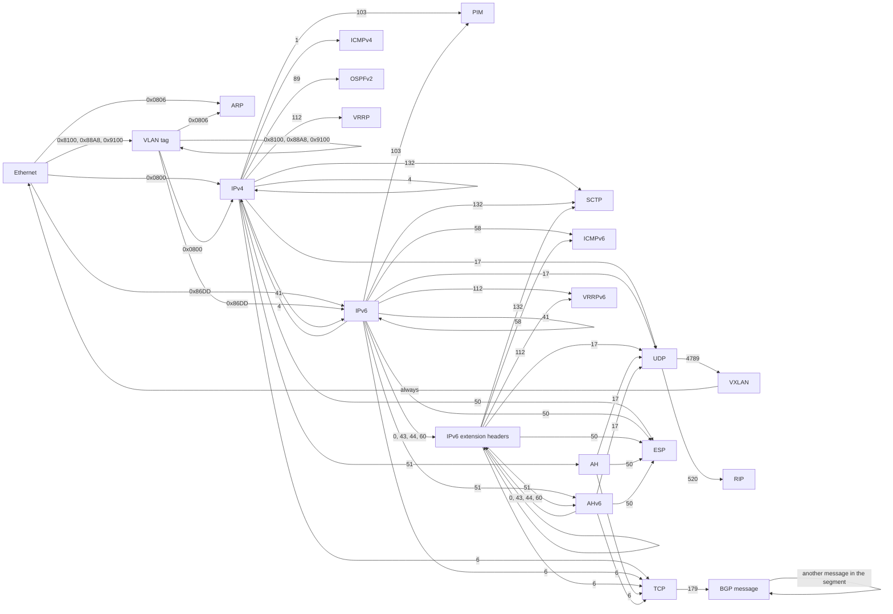

# How NETProtocols works

This is a guided tour of the library's inner workings, written for
anyone who wants to contribute a protocol, fix a bug, or simply
understand how raw bytes become Python objects and back. No prior
experience with packet dissection is assumed — only curiosity and a
little Python.

## A header is just bytes at fixed positions

Here are the first 14 bytes of a real captured frame — an Ethernet II
header announcing an ARP packet:

```
ff ff ff ff ff ff   00 07 0d af f4 54   08 06
└───────────────┘   └───────────────┘   └───┘
 destination MAC       source MAC     EtherType
   (broadcast)                        0x0806 = ARP
```

Every protocol header works like this: a sequence of fields, each at a
known offset with a known width, in network byte order (big-endian).
Parsing one is nothing more than slicing the right bytes and
interpreting them as integers or addresses.

## From bytes to a dataclass

Each protocol is a **frozen, slotted dataclass** whose fields mirror
the wire format, plus a class-level `struct.Struct` describing the
fixed portion's layout. For the header above:

```python
@dataclass(frozen=True, slots=True)
class Ethernet(Protocol):
    dst: str        # "ff:ff:ff:ff:ff:ff"
    src: str        # "00:07:0d:af:f4:54"
    ethertype: int  # 0x0806

    _struct: ClassVar[Struct] = Struct("!6s6sH")
```

The format string `"!6s6sH"` reads: network byte order (`!`), two
6-byte strings (the MACs), one unsigned 16-bit integer (the
EtherType). The `Struct` is compiled once at class definition time —
decoding a million frames reuses the same compiled object.

Three design choices worth knowing:

- **Frozen + slots**: instances are immutable (safe to share, hash,
  and compare) and carry no `__dict__` (cheap to allocate by the
  million during live capture).
- **Friendly field types**: addresses are stored as their canonical
  strings, everything else as `int`, options as `bytes`. What you see
  in a `repr()` is what you work with.
- **Bitfields are explicit**: where the wire packs several fields into
  one integer (IPv4's version/IHL byte, TCP's offset/flags word), the
  decode method splits them with shifts and masks you can read:

  ```python
  ihl = ver_ihl & 0x0F
  version = ver_ihl >> 4
  ```

## Structural pattern matching

Every decoded header works with `match`/`case` today, and nothing in
`src/` was written to make that true — it falls out of the two design
choices above, for reasons worth being precise about:

```python
match eth:
    case Ethernet(ethertype=EtherType.IPV4):
        ...

match ip:
    case IPv4(protocol=IPProtocol.TCP, ttl=t) if t > 32:
        ...
```

1. **`@dataclass` auto-generates `__match_args__`** from the field
   declaration order — `Ethernet.__match_args__ ==
   ('dst', 'src', 'ethertype')` — so a *positional* class pattern
   (`case Ethernet(dst, src, ethertype)`) works with no extra code. An
   ordinary class has to declare `__match_args__` by hand to get that.
   Most headers here never do either — but a few of the widest ones
   are a deliberate exception: `IPv4`, `TCP` and `DHCP` run to 14, 11
   and 15 fields respectively, so their full auto-generated tuple is
   unusable positionally (nobody writes, or gets right, a
   fourteen-slot pattern). Those three hand-declare a short
   `__match_args__` instead — `IPv4.__match_args__ ==
   ('src', 'dst', 'protocol')` — the two or three fields someone
   drafting a positional pattern actually reaches for. The override is
   documented at each class and pinned by
   `tests/test_pattern_matching.py`, so it cannot drift the way an
   *accidental* override would; keyword patterns
   (`case IPv4(protocol=6)`) are unaffected by any of this and stay
   the documented default (#94). `HTTP` curates one too, of
   properties rather than fields — `('method', 'target',
   'status_code')` — because its two fields are the raw head and body.
2. **Every field with a fixed vocabulary of wire values is an
   `IntEnum`**, defined in [`_enums.py`](src/netprotocols/_enums.py),
   and `IntEnum` subclasses `int`. A *value* pattern therefore matches
   the plain integer the wire actually carries —
   `case Ethernet(ethertype=EtherType.IPV4)` matches an instance whose
   `ethertype` field holds the `int` `0x0800` — with no cast, no
   adapter, and no separate "typed" view to keep in sync with the raw
   field.

Keyword class patterns (`ClassName(field=pattern)`) work on *any*
object exposing that attribute; `__match_args__` is only needed for
the positional form. What a frozen dataclass adds is that the
attribute is guaranteed to exist exactly as declared, with no
proxying: a class pattern here either matches a real field or fails
outright — a mistyped field name in a keyword pattern silently never
matches rather than raising, on any object, dataclass or not, so this
buys reliability rather than a new failure mode, not immunity from
that one. (How this compares to other Python packet libraries is
tracked in `docs/CLAIMS.md`, not stated here — see the embargo notes
there.)

**Keeping this working is a contributor obligation, not a given.**
Field declaration order is part of a class's public API — reordering
fields changes what a positional pattern binds to, silently, for
anyone matching by position. (The curated three are the exception:
`IPv4`/`TCP`/`DHCP`'s hand-declared `__match_args__` is independent of
field order, so reordering *their* fields cannot break positional
matching — but adding or renaming one of the fields the curated tuple
names does need the tuple, and the test pinning it, updated by hand.)
And a field carrying a closed set of wire values should stay an
`IntEnum` sourced from `_enums.py` rather than degrade to a bare
`int`; the moment it does, `case Header(field=SomeEnum.X)` stops
matching and fails silently (the pattern falls through to the next
`case`, it does not raise) rather than loudly.

## The decode contract

`decode(data)` is the heart of the library, and every protocol obeys
the same three rules (spelled out in [`_base.py`](src/netprotocols/_base.py)):

1. **It receives the entire remaining buffer** — everything from the
   start of its header to the end of the captured frame — and parses
   the fixed portion with `_struct.unpack_from`. A buffer too short
   for the fixed portion raises `TruncatedHeaderError`.
2. **Variable-length headers finish the job themselves.** IPv4 reads
   its IHL and TCP reads its data offset, sanity-checks it (5–15, and
   the declared bytes must exist in the buffer — a header that *lies*
   about its length raises `TruncatedHeaderError`), then slices its
   `options` as materialized `bytes`.
3. **Trailing bytes are fine.** Whatever follows the header belongs to
   the next layer. After decoding, `instance.header_len` says exactly
   how many bytes this header consumed — a *property*, so IPv4 answers
   `ihl * 4` and TCP answers `data_offset * 4`.

**Three protocols vary this.** The first is text framing. `HTTP` has no
fixed portion to unpack: `decode()` scans for the empty line that ends
the head, then for the end the head's framing gives the body, so rule 1
is a scan rather than an unpack and `header_len` covers the whole
message, not a `_struct` size. Its `decode()` also takes keyword-only
context the bytes cannot carry — `request_method` (a response to `HEAD`,
or a 2xx to `CONNECT`, has no body whatever its headers say) and
`closed` (the buffer ends where the connection did) — and
`request_method` is stored, but normalized: kept only when it changes
the framing, so two messages with equal bytes and equal framing compare
equal.

The second is `SCTP`. Like ICMPv4, ICMPv6 and IGMP it has no length of
its own: the packet is the whole IP payload, and the walk does not trim
a frame to the IP header's declared length. Those three keep the whole
buffer, Ethernet's zero padding included: ICMPv4's and IGMP's internet
checksum is unchanged by appended zero bytes, and an IPv6 frame carrying
ICMPv6 is never short enough to be padded. SCTP's CRC32c does change
when zero bytes are appended, so `decode()` walks the chunk headers to
find where the packet ends and leaves a run of zero bytes where the next
chunk would start undecoded, since that cannot begin a chunk and is what
an Ethernet sender normally pads a short frame with. Rule 3 holds for
those zeros; any other trailing bytes become part of the packet. Past
the 12-byte common header `decode()` never raises, like the three it
resembles: a remainder the walk cannot parse — a chunk cut by a snap
length, an IP fragment or an ICMP error's quote, or a nonzero trailer
such as an Ethernet FCS, which cannot be told from a broken chunk — is
kept verbatim in `chunks`, the ports and verification tag still decode,
and `verify()` returns `False`. `parsed_chunks` raises only when the
remainder does not walk: a trailer that happens to (an FCS whose bytes
read as a chunk header) parses as a phantom chunk, so `verify()` is the
reliable signal. See
[`layer4/sctp.py`](src/netprotocols/layer4/sctp.py)'s module docstring.

The third is `PIM`. It has no length either, and bounds itself by its
own structure:
a Join/Prune, Register-Stop or Assert ends where its counts and
encoded addresses say, so anything after it is left undecoded, and a
Hello, whose options run to the end of the message, leaves a run of
zero bytes where the next option would start, as SCTP leaves one where
a chunk would. A Register's encapsulated packet runs to the end of the
buffer, which its checksum, over the first 8 bytes only, does not
cover. Past the 4-byte header it never raises either: a body its
parser cannot read is kept whole, for `PIM.message` to report. See
[`layer3/pim.py`](src/netprotocols/layer3/pim.py)'s module docstring.

`RIP` has the same problem one layer up: its 20-byte entries fill the
rest of the UDP datagram, and the walk does not trim to UDP's length
either. It keeps the whole buffer after its 4-byte header, as ICMPv4
and IGMP do, leaving no trailing bytes, so `bytes(RIP.decode(x)) == x`.
Its accessors read whole entries, up to the RFC 4822 authentication
trailer that the first entry's Packet Length locates (when the bytes
there start as a trailer does, `0xFFFF 0x0001`), and report what
is left, fewer than 20 bytes, as `remainder`: an entry a snap length
cut, or a trailer such as an Ethernet FCS, which only the UDP length
could tell apart. Past the header neither `decode()` nor any accessor
raises. Ethernet's zero padding reaches only a message with no entries,
since one entry already fills the minimum frame. See
[`layer7/rip.py`](src/netprotocols/layer7/rip.py)'s module docstring.

`VRRP` has no length field either, but needs no walk: its version and
address count give its exact length (8 bytes, the addresses, and
VRRPv2's 8 bytes of authentication data), so it obeys rule 3 like a
header with a length field and leaves Ethernet's padding undecoded. It
must: a VRRPv3 advert for one IPv4 address is 12 bytes, padded on the
wire, and VRRPv3's pseudo-header carries the message's length.

Decoding accepts `bytes` or `memoryview`. Views are a decode-time
transient only: every stored field is a scalar or materialized
`bytes`, so no decoded object ever aliases the buffer it came from.
You can safely reuse or mutate capture buffers.

Errors form a small typed hierarchy rooted at `ProtocolError`:

```
ProtocolError
├── TruncatedHeaderError     buffer shorter than the header claims
├── InvalidFieldError        field value violates the protocol's rules
│   ├── InvalidMACAddressError
│   ├── InvalidIPv4AddressError
│   └── InvalidManufacturerCodeError
└── MaxDepthExceededError    a frame's chain exceeded decode_frame's max_depth
```

**Every raise carries structured context, not just a message.** A
formatted string is easy for a human to read and impossible for a
fuzzer, conformance suite, or validation tool to act on without
regexing it — so every raise site in `src/` attaches `protocol` (the
class that raised) and, where meaningful, `field` (the attribute at
fault), `offset`, and `expected`/`actual`:

```python
try:
    packet = decode_frame(frame)
except ProtocolError as e:
    print(e.protocol, e.field, e.offset, e.frame_offset, e.expected, e.actual)
```

`offset` is relative to whatever buffer the error was found in. An
error raised by `decode()` is relative to that call's `data` argument,
whatever `field` names: OSPF's framing errors name `field="body"` (or
`"auth_trailer"`) and still count from the start of the OSPF header,
which is what lets `decode_frame` rebase them. An error raised later,
by an accessor that parses a raw `bytes` attribute on demand
(`options`, `body`, `sections`, `chunks`), is relative to that
attribute — a TCP option error's `offset` is relative to
`header.options`, an ICMPv6 NDP option's or an IGMPv3 group record's
to `body`, not to the frame. `decode_frame` is the only code holding
the cursor needed to rebase a layer's own offset to the whole frame,
so it does — the result lands in `frame_offset`, left `None` by a
bare `SomeClass.decode()` call with no frame to rebase against. A
`__post_init__` validation error (values, not bytes) leaves `offset`
`None` too; there is nothing to be positioned in. `HTTP` is the
exception on both counts: its `field` names a grammar element
(`"chunk-size"`, `"start_line"`, `"raw_body"`), and its `offset` is
relative to the start of the message — the `decode()` buffer, or
`head + raw_body` for an error raised while constructing one, which
does have bytes to point into.

All five fields default to `None` and adding them never changes a
message string — every existing `str(err)` and `match=` assertion
holds unchanged.

## Walking a frame: the next_protocol() chain

A captured frame is a chain of headers, each one naming what it
carries. In this library that fact is typed: every decoded header
answers `next_protocol()` with the *class* that decodes its payload,
or `None` when the chain ends (nothing encapsulated, a protocol this
library doesn't implement yet, or a payload no header names in the
clear — ESP's Next Header sits in its protected trailer, encrypted
unless the Security Association uses a confidentiality-free transform
(e.g. NULL, RFC 2410, or AES-GMAC, RFC 4543), and at an offset only
the SA determines, so the decoder never reads it).

`BGP` is the one exception, and it answers from decode context rather
than from a wire field. A BGP message carries no payload: a TCP segment
can hold several messages back to back, each decoded as its own layer,
so `BGP.next_protocol()` names the next message *beside* it — `BGP`
when the bytes after this message begin another one, `None` when they
do not. Only those bytes can say which, and `next_protocol()` is handed
none, so `decode()` records the answer on the instance in a field kept
out of the dataclass's comparison and hash (`compare=False`, the
mechanism `HTTP` uses for its `_message` parse cache). Two equal
messages compare equal however they were found, and can still chain
differently. The rules of the decode contract hold for it unchanged;
see *Port-based dispatch is best-effort* below,
[`_base.py`](src/netprotocols/_base.py)'s *Decode context in
next_protocol*, and
[`layer7/bgp.py`](src/netprotocols/layer7/bgp.py)'s module docstring.



IPv6 extension headers (Hop-by-Hop Options, Routing, Fragment,
Destination Options) chain like any other protocol — each names what
follows via `next_header` — and may stack. Two guardrails: the
registry hands them out only inside an IPv6 chain (a garbage IPv4
packet with `protocol=0` cannot conjure a Hop-by-Hop layer), and a
Fragment header chains onward only when `fragment_offset == 0` — a
non-first fragment carries a slice from the middle of the original
payload, so no upper-layer header exists at its start. The same
offset rule applies to fragmented IPv4.

IPsec's AH chains the same way, through its own `next_header`, onward
to anything the IP header before it could have carried (the diagram
draws only the transport, ESP and extension-header edges). It comes as
a pair for that reason: `AH` after IPv4 and `AHv6` after IPv6 have one
wire format but dispatch through their own family's table, so IPv4 →
AH → `0` stops rather than conjuring a Hop-by-Hop layer, while IPv6 →
AH → Destination Options — an order RFC 8200 §4.1 permits — keeps
decoding. VRRP is the other pair, for a different reason: it ends the
walk, but its list of virtual addresses is 4 bytes an entry after IPv4
and 16 after IPv6, which nothing in the VRRP header says, so `VRRP`
reads the one and its subclass `VRRPv6` the other. ESP, the other IPsec header,
ends the walk: what it carries is named only inside its protected
trailer.

VLAN tags chain the same way: a tag's `next_protocol` dispatches the
inner EtherType through the same registry Ethernet uses, so a QinQ
(`0x88A8`) or legacy double-tagged (`0x9100`) frame decodes as one
`VLAN` layer per tag and the innermost payload (IPv4/IPv6/ARP) chains
normally. The Tag Control Information word is split into its semantic
bitfields — `pcp`, `dei`, `vid` — as dataclass fields validated in
`__post_init__`, with the packed 16-bit view kept as the `tci`
property (the same pattern `IPv6` uses for `version` /
`traffic_class` / `flow_label`).

The numbers on the arrows are the wire values — EtherTypes out of
Ethernet, IP protocol numbers out of IPv4/IPv6 — and they live in
[`_enums.py`](src/netprotocols/_enums.py) as `EtherType` and
`IPProtocol`. IPv4 and IPv6 share one registry because the number
space is shared (1 is ICMPv4, 58 is ICMPv6, 6 is TCP, 17 is UDP, 132
is SCTP, 103 is PIM — no collisions; 51 is AH and 112 is VRRP in
both, each decoded by a class of each family's own). 89 is the
exception: it is OSPF in both families, but OSPFv2 (RFC 2328) after
IPv4 and OSPFv3 (RFC 5340), a different wire format, after IPv6, and
this library decodes only OSPFv2, so `OSPF` is reached from IPv4
alone.

A complete frame walk is a five-line loop — which is exactly why it
ships as [`decode_frame()`](src/netprotocols/walk.py) rather than as
something every caller retypes:

```python
packet = decode_frame(frame)          # Packet(Ethernet(...), IPv4(...), TCP(...))
```

Underneath it is the loop the two answers imply:

```python
layers, cursor, protocol = [], 0, start
while protocol is not None:
    header = protocol.decode(frame[cursor:])
    layers.append(header)
    cursor += header.header_len
    protocol = header.next_protocol(registry)
```

The shipped version adds what a copy-pasted loop never has: a bounded
depth (`max_depth`, so a crafted frame cannot make the walk grind), an
explicit `start=` layer for buffers that begin mid-stack, a `lax=True`
mode that reports partial success on `packet.stopped_by` instead of
raising, and the `registry`/`decode_as` hook above. The walk slices
whatever it is handed and never converts: `bytes` stays fastest for one
frame, a `memoryview` over a big capture buffer stays zero-copy.
Wrapping each frame in a `memoryview` internally measured *slower*
(0.95x on the corpus), so the walker does not.

**Where do those arrows live?** Not in the protocol classes. Every
one of them is a row in a dispatch table owned by
[`registry.py`](src/netprotocols/registry.py), and `next_protocol()`
is a single `dict.get` against one of five tables named after the wire
field they dispatch on:

| Table | Dispatches on | Read by |
|---|---|---|
| `ethertype` | Ethernet II EtherType | `Ethernet`, `VLAN`, `GRE` |
| `ip.proto` | IPv4 `protocol` | `IPv4`, `AH` |
| `ip.proto.v6` | IPv6 `next_header` | `IPv6`, extension headers, `AHv6` |
| `udp.port` | UDP well-known port | `UDP` |
| `tcp.port` | TCP well-known port | `TCP` |

`ip.proto.v6` **inherits** `ip.proto`: the two share a number space
but not a table, because the four extension headers must be reachable
only inside an IPv6 chain. Registering in `ip.proto` reaches both,
except at a key `ip.proto.v6` owns itself (51 and 112, below); registering in
`ip.proto.v6` reaches the v6 chain alone. Inheritance
is resolved when you register, not when you look up, so the gating
costs nothing on the hot path — an IPv4 packet with `protocol=0`
cannot conjure a Hop-by-Hop layer because the table it reads has no
entry for `0`.

A child's own registration also *shadows* the inherited entry, which
is how AH's and VRRP's pairs are wired: `AHv6` is registered in
`ip.proto.v6` first, then `AH` in `ip.proto` (and `VRRPv6`, then
`VRRP`, likewise), and the parent write is not inherited over a
key the child already owns. That works the other way round too: a
third party replacing protocol 51 or 112 in `ip.proto` (`override=True`)
changes IPv4 dispatch only, and must register in `ip.proto.v6` as well
to reach IPv6. `_defaults.FAMILY_SPECIFIC_NUMBERS` names the numbers
wired this way, and the tests hold the two tables to differing only at
those keys, the IPv6-only numbers and the IPv4-only one below.

A child can also own a key with no class. Protocol 89 is OSPFv2 in
`ip.proto` and would be inherited into `ip.proto.v6`, where it means
OSPFv3, so every OSPFv3 packet would fail to decode as OSPFv2; instead
the defaults withhold 89 from `ip.proto.v6` (`_defaults.IPV4_ONLY_NUMBERS`)
before registering `OSPF` in `ip.proto`. A withheld key is skipped by
inheritance as an override is, so an IPv6 packet with next header 89
ends its walk at the IPv6 header, as it did before `OSPF` existed, and
a later write to `ip.proto` does not reach it; an OSPFv3 decoder
registered directly in `ip.proto.v6` fills it. `OSPF.decode()` also
rejects any version but 2, for a caller who sends it OSPFv3 on purpose
(`start=` or `decode_as`).

A row need not name a class of its own. IP-in-IP (protocols 4 and 41)
has no header between the outer IP header and the inner one, so its
rows in `ip.proto` point straight at `IPv4` and `IPv6`, and a tunneled
packet walks `IPv4 → IPv4 → …` with no marker layer, as in scapy and
dpkt. Anything that needs "the" IP header of a transport layer must
therefore take the nearest one before it, as `Packet.with_checksums()`
and `Packet.flow_key()` do, not the first.

**Extending the walk without forking.** The tables are public. A
protocol this library does not implement — a proprietary telemetry
header, say, sent under 0x88B5, which IANA's EtherType registry lists
as "IEEE Std 802 - Local Experimental Ethertype", so no built-in
decoder holds it — is one registration away from participating in
frame walks like any built-in:

```python
from netprotocols import Protocol
from netprotocols.registry import register

@register("ethertype", 0x88B5)
class Telemetry(Protocol):
    ...
```

Registrations land in the process-wide `DEFAULT` registry. When they
must not — you are embedding this library, or isolating a test — build
your own with `Registry.from_defaults()` and hand it to the caller
that walks frames. Registering over an existing entry raises
`RegistryConflictError` unless you pass `override=True`, so two
packages claiming the same port cannot silently resolve by import
order; re-registering the *same* class to the same key is a no-op,
because a decorator re-runs whenever its module does.

**Why is the built-in map in its own module?** `Ethernet` must name
`ARP`, `IPv4`, and `IPv6` — but `arp.py` imports from the Ethernet
side of the world (EtherType names). Importing layer modules from each
other at module level would create cycles, so the built-in
registrations live together in
[`_defaults.py`](src/netprotocols/_defaults.py), whose imports sit
inside `install()` and run once from `__init__.py` after every
protocol class exists. Shared enums stay in the dependency-free
`_enums.py`. The layer modules bind their table at import, and every
class a header chooses by a field value (EtherType, IP protocol, port)
comes out of a table, never from an import. Two modules do import
another's class, where there is no field to look up. `layer3/icmp.py`
names `IPv4` and `IPv6` to start the walk of the packet an ICMP error
quotes, which is not dispatch, and `layer7/vxlan.py` names `Ethernet`
directly, because a VXLAN payload is always an Ethernet frame. Neither
can form a cycle: `ip.py` and `ethernet.py` import no other layer
module.

## Port-based dispatch is best-effort

The `ethertype` and `ip.proto` tables dispatch on a single
authoritative field: it exists to say what follows. The two port
tables break that model, and differ in kind rather than just in name.
A port is a *guess* — any service may run on any port, and the
discriminator is split across the source and destination ports.
Dispatch therefore checks the destination port first (a request
targets the server's well-known port) and then the source port (a
response comes from it). DNS on UDP 53 and DHCP on 67/68 decode as a
fourth layer; on TCP, port 53 names `DNSOverTCP`, a shim that consumes
the 2-byte length prefix (RFC 1035 §4.2.2) and chains onward, so the
walk stays uniform.

VXLAN on UDP 4789 (RFC 7348) is the one port entry whose payload is a
whole Ethernet frame. `VXLAN.next_protocol()` always answers
`Ethernet`, and the walk carries on from there exactly as it does at
the start of a frame — the inner frame's VLAN tags, ARP, IPv4 or IPv6
dispatch through the same `ethertype` table, and the registry a caller
passed reaches them too. The walker needed no change for this:
`start=` only chooses the first class, and every later one comes from
the previous header's `next_protocol()`, whatever its layer. An
encapsulating endpoint normally sends to 4789, the IANA port (RFC 7348
§5), from a source port hashed from the inner flow, so the
destination-first lookup finds VXLAN even when that hash lands on
another registered port. The same precedence means a DNS reply to a
client whose ephemeral port happens to be 4789 dispatches to VXLAN,
never to DNS (and is then rejected at the I flag about half the time).
Only 4789 is registered, and Linux still gives a vxlan device `dstport`
8472, the port it used before IANA assigned one, when `ip link add`
names none, so a capture from such a device needs
`decode_as={"udp.port": {8472: VXLAN}}`. An ICMP echo tunnelled through
VXLAN walks seven layers (`Ethernet → IPv4 → UDP → VXLAN → Ethernet →
IPv4 → ICMPv4`), and a hostile frame nested in itself gains four per
level until `max_depth` stops it.

Because the guess can be wrong, each application class validates on
decode, but it can only reject what its format lets it tell apart from
noise, and for most formats that is little. DNS needs only its 12-byte
header and DHCP its 236-byte fixed part; past that, almost any bytes
decode cleanly as either, and even a datagram to port 53 with no
payload at all, padded to Ethernet's 60-byte minimum, decodes the
padding as a DNS header. VXLAN can reject more, because its header has
one bit it requires: the I flag, which random bytes leave clear half the
time. Over 10,000 random 300-byte UDP payloads per port, decoded with
`decode_frame(..., lax=True)`, the walk ended with `stopped_by` set for
50.1% of those sent to 4789 and for none of those sent to 53 or 67.
With lengths drawn uniformly from 0-600 bytes instead, in frames not
padded to Ethernet's minimum, the figures are about 52%, 2% and 39%,
and every DNS and DHCP rejection is a payload too short for the fixed
header; padded to the minimum, as on the wire, the DNS figure falls to
0%, since the padding itself decodes as a DNS header. The VXLAN
header cannot reject more than it does: RFC 7348 says to ignore its
reserved bits, so rejecting those would refuse real traffic, such as
the Group Based Policy extension's.

RIP on UDP 520 rejects the most, because two of its four header bytes
have values no RIP message carries: `RIP.decode()` requires version 1
or 2 and a nonzero command, which 510 of the 65,536 two-byte prefixes
satisfy, so about 99.2% of random datagrams are rejected. Measured the
same way, the walk stopped for about 99.2% in each case: the 300-byte
payloads sent to 520, and the 0-600 byte ones unpadded and padded, the
differences between them within sampling noise; an empty datagram
padded to the minimum is rejected too, since the padding reads as
version 0. It goes no further. The obsolete and extension commands
(TraceOn, TraceOff, the triggered and update messages) decode, and so
does a RIPv1 message with nonzero must-be-zero fields, which RFC 1058
tells a receiver to ignore but a decoder should show. Past the header,
any 20 bytes are an entry.

BGP on TCP 179 (RFC 4271) has the strongest guard of any port entry:
every message opens with a 16-byte Marker of all ones, which random
bytes match once in 2^128, and then a Length and Type whose bounds
depend on each other (§6.1). Measured the same way, over 10,000 random
300-byte payloads and 10,000 of uniformly random length 0-600, padded
or not, every walk to port 179 ended with `stopped_by` set and none
decoded a BGP layer; with the Marker forced to all ones, the Length and
Type checks alone still rejected 9,998 to 10,000 of 10,000 random
300-byte payloads (`random.Random` seeds 0-4). What the port cannot tell the decoder is where a message
starts: TCP cuts its byte stream where it likes, so a segment can hold
several messages, the tail of one, or the head of the next. Each
message decodes as one `BGP` layer, and `BGP.next_protocol()` answers
`BGP` while another message begins in the same segment. It is handed no
bytes, so `BGP.decode()` records the answer on the instance, in a field
outside its comparison and hash (see *Walking a frame* above). A
segment that ends inside a message raises `TruncatedHeaderError` at
that message (lax mode keeps the ones before it); one that begins
inside a message fails the Marker check, or raises
`TruncatedHeaderError` if it is shorter than a header; a bare ACK, like
one on port 53, sends an empty payload into the decoder. A segment of many small messages is a deep
chain, and here `max_depth` bounds correctness, not just cost: the
default leaves room for 29 messages after Ethernet, IPv4 and TCP, and
valid segments hold more. A 1448-byte one holds 76 KEEPALIVEs or 30
one-prefix UPDATEs, and a capture taken with GRO or TSO on, over
loopback or on a jumbo-frame link sees segments of up to 64 KB, so a
strict walk raises `MaxDepthExceededError` on valid traffic and a lax
one stops with `stopped_by` set and `consumed` short of the frame. A
larger `max_depth` or a second walk,
`decode_frame(frame[packet.consumed:], start=BGP)`, decodes the rest;
the busiest segment of the captured session in the corpus, taken with
offload off, carries 7. Reassembling
the stream is the caller's, as it is for `HTTP` below: see
[`layer7/bgp.py`](src/netprotocols/layer7/bgp.py)'s module docstring.

A rejected guess takes the ordinary decode-error path: the chain keeps
the layers it did decode and records the failure. An accepted one
yields a layer that decoded cleanly and is wrong, and nothing in the
`Packet` says so. A caller who needs certainty does not leave it to the
port: `decode_as` or a derived `Registry` names the class for a port
the caller knows, overriding the default for that walk. Third-party
entries in the port tables carry the same risk and no more: a wrong
registration costs what a wrong guess does.

`HTTP` is deliberately absent from the `tcp.port` table. The unit a
datagram protocol decodes is the payload; HTTP's is a message, which
TCP delivers as a byte stream cut wherever it likes. Registering it
(`decode_as={"tcp.port": {80: HTTP}}` works) only decodes the messages
that happen to fit in one segment. Of the 98 frames in
`tests/fixtures/http/http.pcap`, 8 decode; the 70 with no payload
(handshake, ACKs, FINs) and the 8 holding only the start of a message
raise `TruncatedHeaderError`, and the 12 that begin mid-message raise
`InvalidFieldError`. So it needs `lax=True`, and it is still not
reassembly. Reassemble the connection and call `HTTP.decode()` on its
bytes instead.

## The encode side, and the round-trip guarantee

Every class also works in reverse. Constructors take the friendly
forms (string addresses, integer fields) and validate some of them in
`__post_init__`: Ethernet, ARP and IPv4 check address formats (IPv6,
DHCP, VRRP and OSPF do not, so a malformed address there fails only
in `bytes()`; for OSPF's `router_id`, `area_id` and its records'
address fields, such as an LSA header's `advertising_router`, that
is the `OSError` from `socket.inet_pton`), and IPv4's IHL and TCP's
data offset must agree with
`len(options)`. For a valid header, `bytes()` re-emits the exact
on-wire form. Constructors do not check everything decode does, so
some headers can be built that decode would never produce (see
below).

The test suite enforces the round trip in both directions for every
protocol:

```python
Protocol.decode(bytes(header)) == header        # object → wire → object
bytes(Protocol.decode(raw)) == raw[:header_len] # wire → object → wire
```

The first holds for canonical headers, the ones decode itself
produces, when decode is given the context it produced them with
(HTTP's `request_method` and `closed`). A constructor accepts more
than that, and for those headers the first line can fail: spellings
are normalised on the way back (a MAC written with dashes decodes with
colons, an IPv6 address decodes compressed); GRE's optional `fields`
must agree with its flag bits; and VXLAN accepts a clear I flag on
purpose, so that a test of another stack can send one, though
`VXLAN.decode()` rejects it as its guard against a wrong port guess
(see *Port-based dispatch is best-effort*). The round-trip property
tests generate canonical headers only: addresses spelled as decode
spells them, GRE fields sized from its flags, VXLAN with the I flag
set, and HTTP messages that either need no context or are decoded with
the context they carry.

One deliberate boundary: **decode and encode carry checksums
verbatim** — exactly what you want when faithfully re-encoding
captured traffic. Computing and verifying them is explicit, via
`netprotocols.checksum`: `compute()`/`verify()` handle the IPv4 header
checksum, ICMPv4, and TCP/UDP/ICMPv6 with their IPv4/IPv6
pseudo-headers, PIM (the pseudo-header over IPv6 only, a Register's
first 8 bytes only), and `Packet.with_checksums(payload)` fills a whole
stack before sending. (The RFC 768 subtlety lives where it belongs:
the `0x0000 → 0xFFFF` substitution applies to UDP alone.) SCTP is the
one transport that does not use the internet checksum: its CRC32c
(`crc32c()`, RFC 9260 Appendix A) covers the whole packet with no
pseudo-header, and goes on the wire least significant byte first, so
`compute()` returns it byte-swapped to match the field as decoded.
VRRP's checksum is the internet checksum of the message alone in
VRRPv2 and behind the IP pseudo-header in VRRPv3. RFC 5798 §5.2.8
cites only IPv6's pseudo-header; adding IPv4's too is keepalived's
default, and `compute()`'s. RFC 9568, which obsoletes RFC 5798, leaves
it out over IPv4, and `verify()` returns `False` for an advert
checksummed that way.

That is also why `SCTP.decode()` bounds its own extent (see "The decode
contract" above): otherwise Ethernet's padding would land inside the
CRC's span, and a packet under 46 bytes from a real NIC would fail to
verify.

OSPF carries two checksums. The packet's is the internet checksum of
the whole packet but its 64-bit Authentication field, with no
pseudo-header, and `compute()` covers only the packet's own bytes, so
an RFC 5613 LLS block after it never enters; under cryptographic
authentication (AuType 2, or 3 from RFC 7474) none is computed (the
digest protects the packet), so `compute()` raises, `verify()` returns
`True` and `with_checksums()` leaves the field alone. Each LSA's LS
Checksum is an ISO 8473 Fletcher checksum of the LSA but its LS Age;
an LSA is not a layer, so it has functions of its own:
`lsa_checksum()` generates the field with `fletcher_checksum()`, and
`verify_lsa()` checks it the way RFC 905 B.4 does, by both running sums
being zero, so a byte stored as `0x00` where the generator writes
`0xff` passes; and, since RFC 2328 §12.1.7 says the field cannot be
zero, it fails a field of `0x0000` even where those sums are zero.

`Packet` is the thin composition layer: it holds an ordered tuple of
headers and `bytes(packet)` joins them, ready for a raw socket.

## Layout map

```
src/netprotocols/
├── __init__.py     public API re-exports, __version__, registry install
├── _base.py        Protocol ABC, decode contract, address helpers
├── _tlv.py         walk_kind_length_value(): shared TCP/IPv4/IPv6
│                   options and PIM Hello options TLV walker
├── _enums.py       EtherType, IPProtocol, ARPOperation (imports nothing)
├── registry.py     public dispatch tables: register(), Registry
├── walk.py         decode_frame(): the shipped chain walker
├── _defaults.py    the built-in decoder map, installed at import
├── packet.py       Packet composition, with_checksums(), flow_key()
├── checksum.py     RFC 1071 internet_checksum, SCTP's crc32c,
│                   compute, verify, OSPF's LSA Fletcher checksum
├── flow.py         FlowKey, flow_key(): canonical bidirectional keys
├── pcap.py         read_captures()/read_pcap()/read_pcapng(): classic
│                   pcap and pcapng readers, from bytes not filenames
├── layer2/         ethernet.py, arp.py, vlan.py (802.1Q / 802.1ad)
├── layer3/         ip.py (IPv4 + IPv6), icmp.py (ICMPv4 + ICMPv6),
│                   igmp.py, gre.py, esp.py (IPsec ESP),
│                   ah.py (IPsec AH: AH + AHv6),
│                   ospf.py (OSPFv2: OSPF + its message records),
│                   pim.py (PIM-SM),
│                   vrrp.py (VRRPv2/v3: VRRP + VRRPv6),
│                   ipv6_ext.py (Hop-by-Hop, Routing, Fragment,
│                   Destination Options)
├── layer4/         tcp.py, udp.py, sctp.py, _ports.py (port-table
│                   dispatch)
├── layer7/         dns.py, dhcp.py, http.py (the HTTP/1.1 grammar
│                   and the HTTP codec class), vxlan.py, rip.py
│                   (RIPv1 + RIPv2), bgp.py (BGP-4 messages)
└── utils/          validators (mac.py, ipv4.py), exceptions.py
tests/              one file per protocol + test_contract.py
                    (truncation, lying lengths, chain walks),
                    test_corpus.py (invariants over the real-capture
                    corpus in tests/fixtures/ — see its MANIFEST.md for
                    the frame and scenario counts), test_checksum.py
                    (corpus checksums recompute to wire values), and
                    test_fuzz.py (hypothesis properties: decode never
                    raises outside ProtocolError)
```

Tooling: [uv](https://docs.astral.sh/uv/) manages the environment
(`uv sync`); `uv run pytest`, `uv run mypy` (strict), and
`uv run ruff check` are the three gates CI enforces on Python
3.12–3.14.

## Cookbook: adding a protocol

Say you want to add DNS (sitting behind UDP). The pattern is always
the same:

1. **Model the fixed header.** Create `layer7/dns.py` with a frozen,
   slotted dataclass: one field per header field, a `_struct` for the
   fixed portion (`"!HHHHHH"` for DNS: id, flags, and four counts).
2. **Implement `decode()`.** Call `cls._unpack_fixed(data)`, split any
   bitfields explicitly, and construct the instance. If the header is
   variable-length, validate the declared length against `len(data)`
   (raise `TruncatedHeaderError` when the buffer can't satisfy it) and
   materialize the variable part as `bytes`.
3. **Implement `__bytes__()`.** Pack the same fields back; the
   round-trip tests will hold you honest. When a payload is
   self-referential — DNS names compress by pointing at earlier bytes,
   so re-encoding a parsed record cannot reproduce the original — keep
   that region as raw `bytes` and parse it through read-only accessors
   that never re-encode. `bytes(decode(x)) == x` then holds by
   construction (see `layer7/dns.py`).
4. **Wire the chain.** Register the class against the value that
   names it, in the table that carries that value — `register("udp.port",
   53, DNS)`. Nothing in the layer below changes. If you are adding a
   protocol *to this library* rather than to your own program, add the
   wire value to `_enums.py` too (display name in lockstep — a test
   enforces it) and put the registration in `_defaults.py` alongside
   the rest. Numbers valid only inside an IPv6 chain go in
   `ip.proto.v6` rather than `ip.proto`, which is the whole of the
   gating. Reuse the shared helpers rather than re-deriving the same
   pattern in a new module: `hex_str`
   ([`_base.py`](src/netprotocols/_base.py)) for a hex-formatted
   field, the `_ip_protocol_enum`
   ([`layer3/ip.py`](src/netprotocols/layer3/ip.py)) /
   `_ethertype_enum` ([`layer2/ethernet.py`](src/netprotocols/layer2/ethernet.py))
   pattern for an enum-or-`None` accessor, and `walk_kind_length_value`
   ([`_tlv.py`](src/netprotocols/_tlv.py)) for TLV-shaped options.
5. **Add display properties** for anything a human would want rendered
   (`flags_str`-style names, hex strings). Degrade gracefully on
   unknown values — return `"unknown (47)"`, never raise from a
   display helper.
6. **Test with real bytes.** Capture or craft a real header, add it as
   a fixture, and cover: a decode with asserted fields, both round
   trips, truncated input, and (if variable-length) an options case
   and a lying-length case. Export the class from `__init__.py`.

Steps 1–3, 5 and 6 are the same whether the protocol ships here or in
your own package; only step 4 differs, and only in *where* the
registration lives. A protocol carried as a byte stream, as HTTP is
over TCP, skips step 4 altogether (see "Port-based dispatch is
best-effort" above) and replaces step 1's struct with a scan.

If you follow the six steps, your protocol automatically composes with
`Packet`, participates in frame walks, and inherits the library's
error behavior — that's the whole point of the shared contract.
